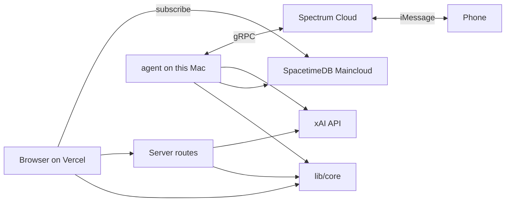

# Architecture

Phase 0 only. Later phases add rows here when they land. Keys stay on the server. No mp3 is written to disk.

## Folders

- `app/` — the website judges open, plus server routes. `app/page.tsx` subscribes to SpacetimeDB and does not call data APIs on load. `app/api/tts/route.ts` streams speech when someone hits play or a text needs a voice note.
- `lib/core/` — the only place that builds tags and the spoken script. The page and the agent both call it.
- `lib/spacetime.ts` — the public host and database name (`https://maincloud.spacetimedb.com`, database `mhacks2026`) and the `IncidentRow` type. It does not open the connection itself.
- `lib/module_bindings/` — client code generated by `spacetime generate`. `app/page.tsx` uses `DbConnection` from here to subscribe.
- `spacetimedb/` — the module published to Spacetime Maincloud. Tables: `incident`, `brief`, `message`, `conversation`, `crew_status`. Reducers: `open_incident`, `save_brief`, `log_message`, `set_active_incident`, `set_crew_status`. Dashboard: https://spacetimedb.com/mhacks2026
- `agent/` — long-lived Spectrum process on this Mac (`npm run agent`). Not a Vercel route. During judging the terminal stays open and the Mac stays awake. The public site does not need the Mac.
- `scripts/` — one-shot insert that proves a row shows up without a refresh.

The module is already published with `spacetime publish -s maincloud mhacks2026`. The Next.js app is not on Vercel yet. That deploy is still owed before judges can open a public URL.

## Data flow

The browser never holds `XAI_API_KEY` or Spectrum secrets. It asks `app/api/tts/route.ts` for audio. SpacetimeDB stores spoken script text on `brief`, not audio bytes. The agent process is written, but it does not call Grok yet. On a text it echoes the message and calls `open_incident` through the Spacetime CLI.

A search does not read a file on the laptop. Opening the map requests the current fire list. Clicking a fire, searching an address, or texting the agent calls the APIs for that one thing. The result is written to SpacetimeDB in the cloud. The app does not keep a local copy to answer the next search.

## Phase 0 features

**Live row.** Starts in `scripts/insert-incident.ts`. That script runs `spacetime call open_incident` against `https://maincloud.spacetimedb.com`. `app/page.tsx` subscribes with `DbConnection` from `lib/module_bindings` and rerenders when the `incident` table changes. A row is already stored: title `Phase 0 check`.

**Play the brief.** Starts in `app/page.tsx`. Calls `lib/core/speakBrief.ts` for the script, then `app/api/tts/route.ts`. That route hits `POST https://api.x.ai/v1/tts` and streams the bytes back. Nothing is saved as a file.

**Answer one text.** Starts in `agent/index.ts` when `npm run agent` is running and Photon credentials are set. Spectrum delivers the iMessage. The process replies with the same text and calls `open_incident`. Grok classification is not connected yet. That is Phase 4.

## Roadmap

- **Phase 0, foundations.** Module is on Maincloud and one incident row is in the table. The page subscribes to it. Voice route and iMessage process exist but have not been proven with a real key or a real phone. No vision call. See `MD Shit/REVIEW.md`.
- **Phase 1, fire map.** US perimeters, FIRMS and GIBS toggles, conditions, a cone at 1, 2, 3, and 6 hours. Pinned past fire: Palisades Fire, Los Angeles, January 2025. Clicking a fire opens an incident.
- **Phase 2, impact.** CO2 now and projected, homes in the cone, GBIF animals only, critical habitat, vegetation names, help links. A timed-out source shows "unavailable".
- **Phase 3, NYC brief.** Year built, floors, class, era hazards, `Altered: <year>` from `yearalter1` (does not replace year built). Solar is a DOB NOW Build filing lookup by BBL, only after a search: `Solar permit on file: Yes` or `No record`. Play button speaks the stored script.
- **Phase 4, agent.** NYC calls, fire-name replies (acres, containment, wind, CO2), follow-ups from stored tags, group chat when the text has an NYC address or starts with "Photon", crew status on every open screen.
- **Phase 5, one check.** CO2 estimate for the Palisades Fire against one published figure. Show both numbers and cite the source in the UI.
- **Phase 6, submission.** Starts 9:15am. Devpost, video, pitch. No new features.
