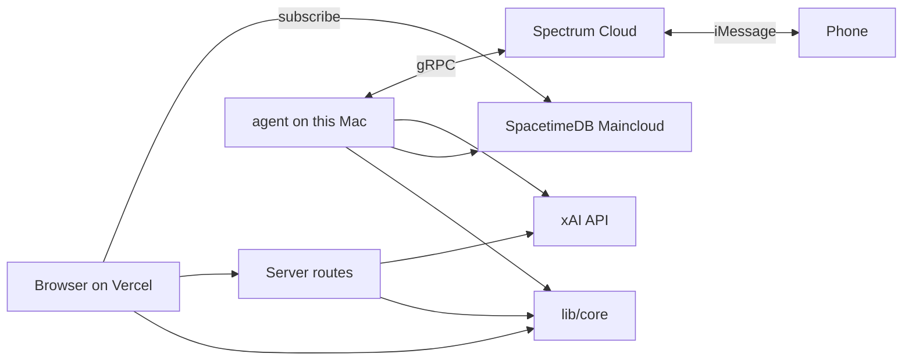

# Architecture

Phase 0 only. Later phases add rows here when they land. Keys stay on the server. No mp3 is written to disk.

## Folders

- `app/` — the website judges open, plus server routes. `app/page.tsx` subscribes to SpacetimeDB and does not call data APIs on load. `app/api/tts/route.ts` streams speech when someone hits play or a text needs a voice note.
- `lib/core/` — the only place that builds tags and the spoken script. The page and the agent both call it.
- `lib/spacetime.ts` — the public host and database name (`https://maincloud.spacetimedb.com`, database `mhacks2026`) and the `IncidentRow` type. It does not open the connection itself.
- `lib/module_bindings/` — client code generated by `spacetime generate`. `app/page.tsx` uses `DbConnection` from here to subscribe.
- `spacetimedb/` — the module published to Spacetime Maincloud. Tables: `incident`, `brief`, `message`, `conversation`, `crew_status`. Reducers: `open_incident`, `save_brief`, `log_message`, `set_active_incident`, `set_crew_status`. Dashboard: https://spacetimedb.com/mhacks2026
- `agent/` — long-lived Spectrum process on this Mac (`npm run agent`). Not a Vercel route. During judging the terminal stays open and the Mac stays awake. The public site does not need the Mac.
- `scripts/` — one-shot insert that proves a row shows up without a refresh.

The module is already published with `spacetime publish -s maincloud mhacks2026`. The Next.js app is not on Vercel yet. That deploy is still owed before judges can open a public URL.

## Data flow

The browser never holds `XAI_API_KEY` or Spectrum secrets. It asks `app/api/tts/route.ts` for audio. SpacetimeDB stores spoken script text on `brief`, not audio bytes. The agent process is written, but it does not call Grok yet. On a text it echoes the message and calls `open_incident` through the Spacetime CLI.

A search does not read a file on the laptop. Opening the map requests the current fire list. Clicking a fire, searching an address, or texting the agent calls the APIs for that one thing. The result is written to SpacetimeDB in the cloud. The app does not keep a local copy to answer the next search.

## Phase 0 features

**Live row.** Starts in `scripts/insert-incident.ts`. That script runs `spacetime call open_incident` against `https://maincloud.spacetimedb.com`. `app/page.tsx` subscribes with `DbConnection` from `lib/module_bindings` and rerenders when the `incident` table changes. A row is already stored: title `Phase 0 check`.

**Play the brief.** Starts in `app/page.tsx`. Calls `lib/core/speakBrief.ts` for the script, then `app/api/tts/route.ts`. That route hits `POST https://api.x.ai/v1/tts` and streams the bytes back. Nothing is saved as a file.

## Map and fire panel

**Open the map.** Starts in `app/page.tsx`, which calls `GET /api/fires`. `listActiveFires` in `lib/core/fires.ts` asks WFIGS for wildfires (`WF`) that are not 100% contained, largest first. Each fire keeps up to eight perimeter parts. Its icon sits at the center of the largest part. `components/FireMap.tsx` draws one flame icon per fire on the CARTO dark vector map. Faint outlines show from zoom 7.

**Base map and overlay dropdowns.** Live in the top-left card on `app/page.tsx`. Dark streets is the CARTO vector style. Satellite is Esri World Imagery, down to street level. NASA VIIRS is yesterday's GIBS true color. The satellite layers sit under the place labels. The Overlay dropdown has:
- "Satellite heat detections, 375 m pixels": with a fire selected, `app/page.tsx` calls `/api/thermal` for the fire's box, and `FireMap` draws each detection as a ground-sized square colored by fire radiative power.
- NOAA-20 band I5 thermal infrared, night or day.
- M11-I2-I1 fire false color.
- Air quality and wind: `/api/weather-grid` loads a 4×4 Open-Meteo grid (forecast wind + air-quality AQI on the same points). Dots are US AQI; arrows point downwind.
- Rain radar: `/api/radar` reads RainViewer's public catalog and serves the latest frame. Tiles stop at zoom 7.

The GIBS overlays are yesterday's (UTC) tiles. MapLibre 6 builds vector tiles in a worker, so `FireMap.tsx` calls `setWorkerUrl("/maplibre/maplibre-gl-worker.mjs")`. `npm install` copies that file into `public/maplibre/` (the `postinstall` script). Without it the vector map stays blank. The MapLibre stylesheet is imported in `app/layout.tsx`. Imported inside the client-only map component, Next.js dropped it, and markers and controls lost their layout. The "Check a New York City building" card at the top of the right panel explains what the search does. A search flies the map to the lot and drops a blue pin. An address without a borough prefers the borough typed, then Manhattan.

**Click a fire.** A click, or picking from the Fire dropdown, calls `openFire` in `app/page.tsx`. That sends `POST /api/fire-detail` with no hours. The route runs `getFireConditions` for the current hour and `getRecovery`. It also runs `airQuality`, `areaRisk`, and `terrainSlope` from `lib/core/risk.ts`, all in parallel. It returns:
- acres burned, containment, and CO2 now, each with a "That is the same as" comparison dropdown (`components/Compare.tsx`, factors in `lib/core/compare.ts`)
- **Risks in this area**: air quality now and the 24 h peak, smoke drift, NWS fire weather alerts, wildfire hazard nearby, people and homes within 5 miles, flash flood risk after rain, and a count of schools, hospitals, and nursing homes only where US AQI is over 100 (Overpass, skipped when AQI is 100 or below), plus one line of EPA-style guidance for sensitive groups
- animals recorded here and critical habitat
- **Fire environment** at the end: fuel type, dead fuel moisture, soil moisture, slope, humidity, wind, and temperature as bars, where longer and redder means more push on spread

The map highlights that fire's perimeter in red and zooms to it.

Slope comes from `terrainSlope`: 10 spots across the fire, each compared with four points 330 m away (Open-Meteo 90 m elevation). The median feeds both the dashboard and the projection. The old single 2 km sample at the center missed the steep ground in Palisades.

**Spread projection dropdown.** In `components/FirePanel.tsx`. Off by default. Picking 1, 2, 3, or 6 hours calls `runProjection`, which sends the same route with `hours`. The route gets the next six forecast hours from `getFireConditions` and the LANDFIRE fuel type. It then runs `projectSpread` in `lib/core/spread.ts`.

Each hour, every bearing around the fire grows. The rate depends on:
- fuel type: grass, shrub, or forest base rates
- dead fuel moisture: computed from temperature and humidity
- soil moisture: a small live-fuel adjustment
- slope
- wind: cut to flame height

The shape is an Anderson ellipse that stretches downwind. Only the uncontained share of the edge grows, centered downwind. Palisades is sent as uncontained, a scenario with today's weather. The result is drawn as a band: the projected outline minus the current fire's outer edge. `countBuildings` counts OpenStreetMap buildings in that band. The panel shows new acres, farthest spread, fuel moisture, buildings, CO2 projected, and weather at the last hour.

**US totals card.** Top left, under the map controls, collapsible, titled "Burning right now in the US". Acres and CO2 each have a comparison dropdown (football fields to Rhode Island; cars, homes, gasoline, tanker trucks, forest needed to absorb it). `GET /api/summary` adds up acres and CO2 for every active fire, with one LANDFIRE sample per fire. `GET /api/summary?part=species` unions GBIF species keys across all perimeters, three fires at a time. It takes about 30 to 40 seconds, so it fills in later.

**Ways to help.** `lib/core/help.ts` holds the links. `FirePanel` shows them in a green card at the top of the panel. It is open when nothing is selected and collapses to a header when a fire is open. Regional groups get a "Near this fire" tag.

**Species photos.** `getRecovery` takes the top eight GBIF species keys. For each one it gets the scientific name from GBIF, then the common name, photo, and credit from iNaturalist `/v1/taxa`. The total species count is the length of the GBIF facet list.

**NYC building details.** `getAddressBrief` now asks PLUTO for land use, units, floor area, lot area, footprint, number of buildings, attachment, basement, extension, second alteration, landmark, historic district, zoning, fire company, and police precinct. They show as "Building details" and "Local services" sections. The DOB solar lookup runs at the same time as PLUTO.

**Answer one text.** Starts in `agent/index.ts` when `npm run agent` is running and Photon credentials are set. Spectrum delivers the iMessage. The process replies with the same text and calls `open_incident`. Grok classification is not connected yet. That is Phase 4.

## Roadmap

- **Phase 0, foundations.** Module is on Maincloud and one incident row is in the table. The page subscribes to it. Voice route and iMessage process exist but have not been proven with a real key or a real phone. No vision call. See `docs/REVIEW.md`.
- **Phase 1, fire map.** The map loads WFIGS perimeters on open. A click calls Open-Meteo and the weather service, draws a 1/2/3/6 hour cone, and writes an incident. Palisades is a history request from its own button. Satellite and hotspot layers toggle on the map.
- **Phase 2, impact.** A click adds CO2 now and projected, GBIF animals, critical habitat, a LANDFIRE name, and help links. Homes use the OpenStreetMap count. A failed source shows "unavailable".
- **Phase 4 agent.** `lib/core/agentReply.ts` plus `agent/store.ts` write through the SDK. Tools table in `lib/core/tools.ts` (three TODO rows). `DEMO_MODE=1` serves `fixtures/demo/palisades.json` and `fixtures/demo/address.json`.
- **Thermal update.** "Animals recorded here" wording. `/api/summary` cached 10 min. The Overlay dropdown has heat-detection squares from `/api/thermal` (`lib/core/thermal.ts`), plus GIBS NOAA-20 I5 day and night and M11-I2-I1 false color. The GIBS WMS dots were removed.
- **Layout cleanup.** Full-screen map, see-through floating cards, a hideable right panel, deselect, click-to-expand rows, no voice button on the web, no emojis.
- **Scale, risks, dashboard update.** NASA hotspots without a key, CO2 and acres comparisons, a separate NYC building card, air quality and area risks, and the fire environment dashboard.
- **Projection and totals update.** Spread uses wind plus natural growth from fuel, moisture, slope, and containment. Species photos. US totals card. Ways to help card. More PLUTO fields. The evacuation line was removed at your request.
- **Map redesign (between Phase 3 and 4).** Dark UI, CARTO vector map, Esri satellite, flame icons for active wildfires, Fire, Base map, and Overlay dropdowns, a Spread projection dropdown, and collapsible panel sections.
- **Phase 3, NYC brief.** Year built, floors, class, era hazards, `Altered: <year>` from `yearalter1` (does not replace year built). Solar is a DOB NOW Build filing lookup by BBL, only after a search: `Solar permit on file: Yes` or `No record`. Play button speaks the stored script.
- **Phase 4, agent.** NYC building briefs (floors, era hazards, solar, first-due), fire-name briefs that reuse the dashboard numbers (acres, wind, AQI, fuel moisture, CO2), follow-ups from stored tags, group chat when the text has an NYC address or starts with "Photon", crew status on every open screen. Overlay: AQI dots and wind lines are separate filters.
- **Phase 5, one check.** CO2 estimate for the Palisades Fire against one published figure. Show both numbers and cite the source in the UI.
- **Phase 6, submission.** Starts 9:15am. Devpost, video, pitch. No new features.
